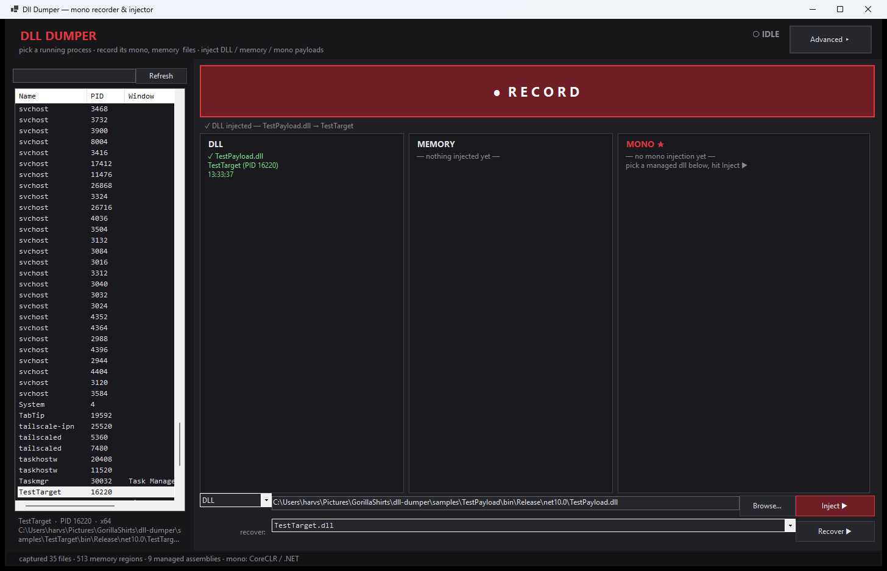

# dll dumper

**A dark little toolbox for picking apart Unity / Mono games — record everything, inject everywhere, pull the dlls back out.**

`dll dumper` is a single-file Windows GUI that attaches to a running process and gives you the
whole picture: the Mono runtime (or CoreCLR), every managed assembly, every export, the full
memory map, and every file the process has loaded. Then it pushes back — inject a native `.dll`,
write shellcode into the target, or fire a C# entry point straight through the Mono runtime.
And when you need the file itself: **Recover** reads any loaded module — including a dll you
just injected — straight back out of the target's memory and saves it to disk.

No NuGet packages. No installer. One `.exe`.



---

## the simple view (default)

1. pick a process on the left
2. hit the big **● RECORD** button — it flips to **■ STOP · 00:06** and counts up live
3. three cards answer the only question that matters — **DLL / MEMORY / MONO ★**:
   `— nothing injected yet —` until something lands, then green
   `✓ TestPayload.dll → TestTarget (PID 1234)` (or red `✗` with the reason to chase in the log)
4. the inject row: mode + payload + **Inject ▶** — mono mode doesn't even need an entry point
   typed, it auto-picks one out of the payload (e.g. `TestPayload.Loader.Load()`)
5. the recover row: pick any loaded module → **Recover ▶** → dumped to a file.
   A dll you just injected shows up in the list automatically.

**Advanced ▸** (top-right) opens the full inspector: mono exports & assemblies, memory map,
mapped files, the recorded session log and the injection ledger.

## features

| | |
|---|---|
| **simple by default** | record → stop → the DLL / MEMORY / MONO cards tell you exactly what got injected |
| **process picker** | live list of every running process (name, PID, window title, memory), filterable |
| **mono inspector** | auto-detects **Mono** *and* **CoreCLR** runtimes, dumps `mono_*` exports, every loaded assembly with type + method counts |
| **memory map** | full `VirtualQueryEx` walk — base, size, state, protect, type, owning module |
| **loaded files** | every module in the target with base address and on-disk size |
| **recorder** | click **● Record** and everything above streams into a timestamped log; **Save report** exports it |
| **3 injectors** | `.dll` loader, memory/shellcode, and Mono runtime invoke — each with a step-by-step log |
| **recover a dll** | dump any loaded module (patched, unpacked, or injected) straight out of the target's memory to disk |
| **injection ledger** | every injection is listed with mode, payload, and result (Success / Fail + why) |
| **single file** | self-contained x64 exe, zero dependencies, .NET 10 |

## the three injection modes

### 1. `.dll` — LoadLibraryW
Classic: write the path into the target, resolve `LoadLibraryW` remotely, spin a thread.
Use this for native plugins, bootstraps, and `.dll` menus.

### 2. memory — shellcode
Write arbitrary bytes into an `RX`/`RWX` region and run them on a fresh thread.
Use this for manual mappers and position-independent stubs.

### 3. mono — managed invoke
Builds a remote argument block (`fn, a0..a3, ret`) and a 41-byte x64 trampoline
(`push rsi / mov regs / sub rsp,0x20 / call rax / store rax / add rsp,0x20 / pop rsi / ret`),
then calls any managed entry point inside the target's own Mono runtime — e.g.
`TestPayload.Loader.Load()`. Works by resolving `mono_add_internal_call` /
`mono_runtime_invoke`-style targets from the runtime module in the target.

Leave the class/method empty and it **auto-picks the entry point** by reading the payload's
metadata (prefers names like `Loader.Load`, `Plugin.Init`, `Main`, `Start`).

Every mode logs each step: rights requested, bytes allocated, remote address, thread exit code,
module handle — so when something fails you know exactly where.

## recover a dll

Pick a module in the **recover** dropdown (a dll you just injected lands there automatically)
and hit **Recover ▶**. The module is read page-by-page out of the target's memory — guarded
pages become zeros instead of killing the dump — and rebuilt as a PE file on disk: headers
plus every section at its raw offset, metadata intact. Works for patched modules, unpacked
sections, injected payloads — anything mapped in the target.

## quick start

```powershell
# build
dotnet build DllDumper.slnx -c Release

# run
DllDumper.exe

# or launch with a process + tab preselected (handy for testing)
DllDumper.exe TestTarget Recorded
```

1. pick the target in the left list
2. hit the big **● RECORD**, let it run, hit **■ STOP** — the cards now answer "did anything land?"
3. browse to your payload, pick a mode, hit **Inject ▶** — mono mode auto-picks the entry point
4. need the file itself? pick it in **recover** → **Recover ▶** → dumped to disk
5. **Advanced ▸** holds the full detail: **Mono / Memory / Files / Recorded / Injected** tabs

### samples

`samples/TestTarget` — a tiny x64 console app to practice on.
`samples/TestPayload` — a managed payload exposing `TestPayload.Loader.Load()` for mono-mode tests.

```powershell
dotnet run --project samples/TestTarget -c Release
DllDumper.exe TestTarget
```

## using it with Unity games (Mono builds)

1. start the game and let it reach the main menu
2. select the game in **dll dumper**
3. the **Advanced ▸ Mono** tab shows `mono-2.0-bdwgc.dll` (or similar) with its `mono_*` exports,
   plus every `Assembly-CSharp` / plugin assembly with live type & method counts
4. **● Record** before you mod — you now have a full baseline of the game's state
5. inject your loader `.dll` (mode 1) or a managed entry point (mode 3) — the ★ **MONO** card
   tells you whether the managed side landed
6. recover any module back out of memory whenever you need the file

> IL2CPP builds have no embedded Mono runtime — those will show the file/module list only.
> That's still useful: you can see every mapped file and the memory layout.

## requirements

- Windows 10/11 x64
- for injecting into processes you don't own: run **as administrator**
- .NET 10 runtime *only if you run from source* — the published exe is self-contained

## building from source

```powershell
git clone <this-repo>
cd dll-dumper
dotnet build DllDumper.slnx -c Release
# single-file exe:
dotnet publish src/DllDumper/DllDumper.csproj -c Release -r win-x64 `
  --self-contained true -p:PublishSingleFile=true -p:EnableCompressionInSingleFile=true
```

## disclaimer

This tool is for **your own software** — reverse-engineering, debugging, and instrumenting
processes you own or have permission to test. Injecting into online games will trip anti-cheat
(EAC, BattlEye, Vanguard…) and can get your accounts banned; don't do it. The authors take no
responsibility for misuse.

## license

MIT — see [LICENSE](LICENSE).
